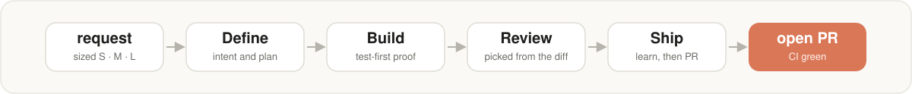

# sdlc

[](https://github.com/tammai/sdlc/releases/latest)
[](https://github.com/tammai/sdlc/actions/workflows/ci.yml)
[](LICENSE)
[](#install)
[](#install)



A Claude Code harness for your SDLC: work sized to fit, Define → Build → Review → Ship, test-first proof, diff-based reviews, and a record of every change.

You describe the work. sdlc decides how big it is, then takes it from intent to an open pull request. It asks you only at the decisions that matter. Everything it needs comes in one plugin.

## What you get

- **Work sized to fit.** A small fix runs straight through. A feature or a project gets a written plan you approve first.
- **Four phases.** Define → Build → Review → Ship, the same on every change.
- **Test-first proof.** Each acceptance criterion has a test that fails before the code is written and passes after.
- **Reviews picked from the diff.** Security, code, UI or none, depending on what the change touched.
- **A record of every change.** Each change commits one file that says why it was made and how it was checked.
- **Guardrails.** Hooks warn or block in real time on secrets, focused tests and force-pushes to main.
- **Any stack, any repo shape.** Setup uses the commands your repo already runs, per package in a monorepo, and generates CI from them.

## Install

```
/plugin marketplace add tammai/sdlc
/plugin install sdlc@sdlc
```

Restart the session so the commands and hooks load.

Optional companions from the same marketplace (`/sdlc:setup` offers them):

- `sdlc-extras@sdlc`: the Ralph loop, hookify commands and extra review agents.
- `sdlc-stepper@sdlc`: a bar above the prompt showing which phase the active feature is in ([README](plugins/sdlc-stepper/README.md)).

**Requirements:** `git`, `gh`, Python 3.9+. Node is needed only for the brainstorm visual companion. Your project needs nothing extra.

**Other coding agents (experimental):**

| Agent | Install |
|---|---|
| Codex | `codex plugin marketplace add tammai/sdlc`, then `codex plugin add sdlc@sdlc` |
| Cursor | Customize → Import from Repo with `https://github.com/tammai/sdlc` |
| Antigravity | `python3 scripts/hosts.py dist antigravity <folder>` in a clone, then `agy plugin install <folder>` |

## Quick start

```
/sdlc:doctor                                     # 1. check the install
/sdlc:setup                                      # 2. set up the repo, once
/sdlc:start add CSV export to the reports page   # 3. start a piece of work
```

- **Setup** runs on its own branch. In an existing repo it records your test, lint and build commands. In an empty repo, add a line saying what you're building, for example `/sdlc:setup a REST API for invoices`, and it creates a skeleton for you.
- **Start** sizes the work and runs it through the four phases:

| Size | When | You decide |
|---|---|---|
| **S** fix | 1–2 files, clear expected behaviour | merge |
| **M** feature | a few files, approach mostly clear | the plan, which reviews to run, merge |
| **L** project | several parts, or an approach still unclear | the same as M, after a short design interview |

The agent stops at the open PR with CI green. Merging, production deploys and database migrations are always your call.

Run `/sdlc:start` with no argument in a new session to resume where you left off.

## Commands

| Command | Does |
|---|---|
| `/sdlc:setup` | Set the repo up once |
| `/sdlc:start [request]` | Start work, or resume the active feature |
| `/sdlc:status` | Where each feature stands |
| `/sdlc:doctor` | Health check, with a fix for each problem |
| `/sdlc:upgrade` | Bring the repo up to the installed plugin version |
| `/sdlc:deploy` | Deploy a shipped feature, with your go-ahead |
| `/sdlc:review-pr`, `/sdlc:code-review` | Review a local diff, or a GitHub PR |
| `/sdlc:commit`, `/sdlc:commit-push-pr` | Commit, or commit, push and open a PR |
| `/sdlc:eject` | Remove sdlc's files from the repo and keep your work |

**Update:** update the plugin from `/plugin`, restart, then run `/sdlc:upgrade` in each repo.
**Uninstall:** run `/sdlc:eject` in each repo, then `/plugin uninstall sdlc`.

## Learn more

- [Guidebook](docs/guidebook.md): how it works
- [Playbook](docs/playbook.md): what to do when…
- [Runbook](docs/runbook.md): install, health checks, fixes
- [Changelog](CHANGELOG.md)
- [Contributing](CONTRIBUTING.md)

## License

MIT, © 2026 Tâm Mai, see [LICENSE](LICENSE). sdlc adapts work from [Superpowers](https://github.com/obra/superpowers), [GitHub Spec Kit](https://github.com/github/spec-kit) and [Anthropic's Claude Code plugins](https://github.com/anthropics/claude-plugins-official). For what came from each one, see [NOTICE.md](NOTICE.md).
