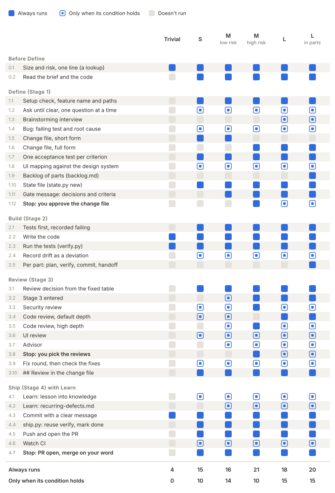

# Which steps run on which track

Every piece of work is sized first, and the size decides which steps run. This page lists every step against each track, so you can see what a change will and won't do before you start it. The source is [`flow.md`](../skills/orchestrator/references/flow.md) (M and L), [`s-track.md`](../skills/orchestrator/references/s-track.md) (S) and the sizing table in [`SKILL.md`](../skills/orchestrator/SKILL.md); if they disagree with this page, they win. The tracks themselves are described in the [guidebook](wiki/How-it-works.md#tracks).

| Mark | Meaning |
|:-:|---|
| ● | Always runs on this track |
| ◐ | Runs only when its condition holds (see [Conditions](#conditions)) |
| · | Doesn't run on this track |

**M low risk** and **M high risk** are the same track; risk (auth, payments, secrets, PII, migrations, a breaking public API, untrusted input reaching a shell, file path or database) only adds stops and reviews. **L in parts** is work split into parts because it won't fit one session (an M can be split too, with the same steps); one part is the default.

## The matrix

The same matrix as a table, with the step names in full:

| Step | Trivial | S | M low risk | M high risk | L | L in parts |
|---|:-:|:-:|:-:|:-:|:-:|:-:|
| **Before Define** | | | | | | |
| 0.1 Size and risk, one line (a lookup) | ● | ● | ● | ● | ● | ● |
| 0.2 Read the brief (`brief.py`) and the code it names | · | ● | ● | ● | ● | ● |
| **Define (Stage 1)** | | | | | | |
| 1.1 Setup check, feature name and paths | · | ● | ● | ● | ● | ● |
| 1.2 Ask until clear, one question at a time | · | ◐ | ◐ | ◐ | ◐ | ◐ |
| 1.3 Brainstorming interview (`sdlc:brainstorming`) | · | · | · | · | ◐ | ◐ |
| 1.4 Bug: failing test and root cause first | · | ◐ | ◐ | ◐ | ◐ | ◐ |
| 1.5 Change file, short form | · | ● | ● | · | · | · |
| 1.6 Change file, full form (decisions, failure modes, out of scope) | · | · | · | ● | ● | ● |
| 1.7 One acceptance test per criterion, written | · | ● | ● | ● | ● | ● |
| 1.8 UI mapping against the design system | · | ◐ | ◐ | ◐ | ◐ | ◐ |
| 1.9 Backlog of parts (`backlog.md`) | · | · | · | · | · | ● |
| 1.10 State file (`state.py new`) | · | ● | ● | ● | ● | ● |
| 1.11 Gate message: decisions and criteria | · | · | ● | ● | ● | ● |
| 1.12 **Stop:** you approve the change file | · | · | · | ● | ◐ | ◐ |
| **Build (Stage 2)** | | | | | | |
| 2.1 Tests first, recorded failing (`verify.py red`) | · | ● | ● | ● | ● | ● |
| 2.2 Write the code | ● | ● | ● | ● | ● | ● |
| 2.3 Run the tests (Trivial: the project's own; others: `verify.py`, the full plan) | ● | ● | ● | ● | ● | ● |
| 2.4 Record drift as a deviation | · | ◐ | ◐ | ◐ | ◐ | ◐ |
| 2.5 Per part: part plan, `verify.py`, commit, handoff | · | · | · | · | · | ● |
| **Review (Stage 3)** | | | | | | |
| 3.1 Review decision from the fixed table | · | ● | ● | ● | ● | ● |
| 3.2 Stage 3 entered (else Build goes straight to Ship) | · | · | ◐ | ● | ● | ● |
| 3.3 Security review | · | ◐ | ◐ | ● | ◐ | ◐ |
| 3.4 Code review, default depth | · | ◐ | ◐ | · | ● | ● |
| 3.5 Code review, high depth | · | · | ◐ | ● | ◐ | ◐ |
| 3.6 UI review | · | ◐ | ◐ | ◐ | ◐ | ◐ |
| 3.7 Advisor | · | · | ◐ | ◐ | ◐ | ◐ |
| 3.8 **Stop:** you pick the reviews | · | · | · | ● | ◐ | ◐ |
| 3.9 Fix round, then a check of the fixes | · | ◐ | ◐ | ◐ | ◐ | ◐ |
| 3.10 `## Review` in the change file (one line if no review ran) | · | ● | ● | ● | ● | ● |
| **Ship (Stage 4) with Learn** | | | | | | |
| 4.1 Learn: a non-obvious lesson into knowledge | · | ◐ | ◐ | ◐ | ◐ | ◐ |
| 4.2 Learn: a line in `recurring-defects.md` | · | · | ◐ | ◐ | ◐ | ◐ |
| 4.3 Commit with a clear message | ● | ● | ● | ● | ● | ● |
| 4.4 `ship.py`: reuse `verify.py`, mark done | · | ● | ● | ● | ● | ● |
| 4.5 Push and open the PR | · | ● | ● | ● | ● | ● |
| 4.6 Watch CI | · | ◐ | ◐ | ◐ | ◐ | ◐ |
| 4.7 **Stop:** PR open, merge on your word | · | ● | ● | ● | ● | ● |
| **Always** | **4** | **15** | **16** | **21** | **18** | **20** |
| **Conditional** | **0** | **10** | **14** | **10** | **15** | **15** |

The step numbers are for talking about the matrix; they aren't in the flow files. The phase numbers (1 to 4) are the `Current: Stage` values in the state file, and they match the first digit of the step numbers. Before 3.0 they were 1, 4, 5 and 8 ([ADR 0022](adr/0022-phases-numbered-one-to-four.md)).

## Conditions

| Step | Runs when |
|---|---|
| 1.2 | something that would change what gets built is unclear; never the same question twice |
| 1.3 | the work is L and no written spec already settles the design |
| 1.4 | the request is a bug: its failing test becomes AC-001 |
| 1.8 | the spec has screens or the diff touches `areas.ui` in `.sdlc/config.json` |
| 1.12 (L) | one of the four self-checks leaves a doubt (check 1 includes `verify.py trace` when the ACs cite a spec); otherwise L approves its own plan and records why |
| 2.4 | the build departs from the plan; Build never stops for it |
| 3.2 (M low) | a review fires; otherwise Build goes straight to Ship |
| 3.3 | `Risk: high`, or the diff touches `areas.sensitive` or `areas.migrations`, or untrusted input reaches a shell, file path or database. Always on M high, because it is `Risk: high` |
| 3.4 | `## Public Surface` isn't `- none`, or the diff is large (over 5 source files or 300 added code lines); always on L. M high takes the high depth instead, since the deepest row that fires is the only code review |
| 3.5 | `Risk: high`, or the spec names a crash mid-write or concurrent use as a failure mode |
| 3.6 | the diff touches `areas.ui`; it runs on S, and on M and L you can decline it |
| 3.7 | an open judgement call the reviews can't settle, and only on an agent that has an advisor |
| 3.8 (L) | you doubt the table's answer; otherwise L runs what fires and records it |
| 3.9 | a review finds a high, or a bug in code the change touched; one fix round, then one check of the fixes |
| 4.1 | the change taught something not obvious from the code or the commit |
| 4.2 | a high finding fixed in Review that a reviewer could check next time |
| 4.6 | there is a remote and CI reports checks; one fix if red because of the code |

A low-risk M doesn't stop for the plan or the review choice: it says what it's doing, records it and goes on. On any track, "skip" or "just ship it" skips steps: they are named and recorded as a deviation.

## Where a use case lands

sdlc doesn't pick a track from a label like "bugfix" or "MVP". It counts the files the change touches, takes the smallest track that fits and sets risk from the list above. These are the usual landings, to help read the matrix; the footprint decides.

| Use case | Usually | Why |
|---|---|---|
| Typo, comment or docs wording, a config value nothing tests | Trivial | no behaviour changes, so no test could tell before from after |
| Bug fix | S (M if it spreads over a few files) | any change a test could catch is at least S; step 1.4 applies |
| Refactor | S or M by footprint | it changes code a test can see; there is no refactor-specific mode |
| Small feature or tweak | S, or M low risk | |
| Change to auth, payments, secrets, PII, a migration or a public API | M high risk | adds the approval stop, the security review and the high-depth code review |
| Security patch | S or M by footprint, with `Risk: high` when it touches the list | the security review fires |
| Infra, CI or build config | Trivial if nothing tests it, else S or M by footprint | `areas.migrations` or `areas.sensitive` paths still fire the security review |
| New product, MVP or a project with several distinct parts | L, in parts when it won't fit one session | the brainstorming interview, the full change file, the backlog |
| PoC or spike | sized like any change | there is no throwaway mode: every track keeps the record and the tests |

## Outside the tracks

Not steps of any track; each runs only when you ask:

- `/sdlc:deploy` ships a merged feature through the project's deploy path, with an explicit go-ahead before production or a migration.
- Operate (a watch window and signals after release) is reference only; no track runs it.
- A QA round (`qa-tester`, the black-box tester) and the full security audit (the `security-audit` companion skill, when installed) are on request, at any time.
- Autopilot runs the remaining parts of an L in parts without you, and still stops on the hard stops.
