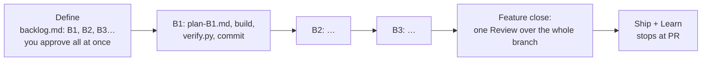

# Big work and autopilot

## 19. A big feature becomes a backlog

Use this for M or L work with several distinct parts that won't fit one session. Never for S, and never for a 1–2 file change.



1. **Define** writes `backlog.md` in `.sdlc/state/<feature>/`: one row per part (`B1`, `B2`, …), each testable on its own, with its ACs, dependencies and size. The state file's `## Tasks` outlines each part.
2. **Each part:** writes `plan-B<n>.md`, builds until `verify.py` passes, commits, and updates `## Handoff` so a fresh session can continue. There's **no review per part**, and parts run back to back without asking.
3. **It stops** only for a backlog change that adds scope, or at a hard stop. To review every part yourself, say so: it records `Slice gates: plan, commit` (either or both).
4. **Low context:** it stops at a part boundary with `B<n> done (<commit>). Next: B<m> <title>. Run /clear, then /sdlc:start.` To run a specific part once its dependencies are done, use `/sdlc:start B<n>`.
5. **Feature close:** all parts land together, in one Review over the whole branch ([6](Everyday-work.md#6-choose-the-reviews-and-act-on-findings)), then Ship.

## 20. Run a backlog on autopilot

Autopilot is opt-in, and it isn't the Ralph loop ([11](#11-run-an-autonomous-loop)). It comes in two forms:

| | In this session | Headless (Claude Code only) |
|---|---|---|
| **Start** | Say `autopilot` (or "run the rest unattended") | `python3 <plugin>/scripts/autopilot.py [--permission-mode <mode>] <feature>` in a terminal at the repo root |
| **Runs** | Every remaining part, then feature close, in this session | Each part in a fresh headless session (`/sdlc:start B<n> --autopilot`), then feature close |
| **Context** | No stop for context: each part's commit and handoff carry it past compaction | A fresh session per part |
| **Review** | Takes the agent's recommendation | Same, recorded |
| **Would ask** (scope change) | Marks that part blocked and continues with the others. A hard stop ends the run | Marks the part `blocked: <reason>` in `backlog.md`, adds an open question, and stops |
| **Permissions** | The session's own | See below |

**Headless permissions.** The sessions must be able to edit files and run git, your commands, and the plugin's scripts (`state.py`, `backlog.py`). The scripts live in the plugin folder, so add it to `permissions.additionalDirectories` if they're denied. Setup's allowlist covers only your commands, so pass `--permission-mode` or widen the allowlist. A denied session leaves its part unchanged (`B<n> is still todo after its run`). Autopilot passes the mode to `claude` as given and **never adds a permission-bypass flag**.

**Headless stops** on: an open trust-anchor notice, an inactive feature, a blocked part, nothing ready, a failed session, a run that left its part unchanged, or a feature close that didn't reach Ship. It prints one JSON object with the reason and the parts it ran. Fix the cause in a normal session (for a blocked part: `/sdlc:start B<n>` and answer its question), then run the same command again.

**When it finishes,** Review and Ship are done. **The merge still waits for you**: say merge in a normal session (`/sdlc:start`).

## 11. Run an autonomous loop

The **Ralph loop** repeats one task in the current session. It needs the companion plugin (`/plugin install sdlc-extras@sdlc`, then restart). Use it for one well-specified task with a finish a machine can check:

```
/sdlc-extras:ralph-loop "Make all tests in tests/export pass" --completion-promise "DONE" --max-iterations 15
```

- **Always** set `--max-iterations`.
- Cancel with `/sdlc-extras:cancel-ralph`.
- Use it inside Build only; Review still runs afterwards.
