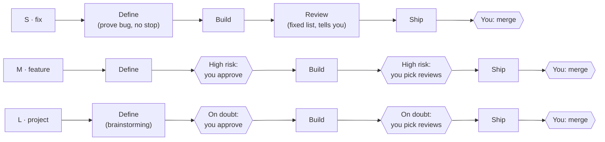
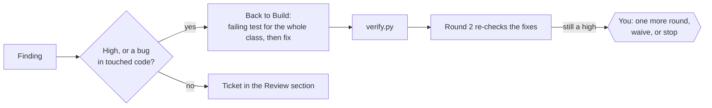

# Everyday work

What to type, what happens, and where you decide. Tracks and phases are explained in [How it works](How-it-works.md).



## 1. Fix a bug (S track)

```
/sdlc:start fix: export button 500s when the report is empty
```

You can also paste a GitHub issue, Linear or Jira link.

1. **Define:** it proves the bug first (a failing test, or exact steps), then finds the root cause. The proving test becomes **AC-001**. It writes the change file and the state file in a few lines each, says in a line or two what it will do, and **doesn't stop**. If what, why or how is unclear, it asks first.
2. **Build:** one call records AC-001 failing (`state.py sync && state.py advance 2 && verify.py red AC-001`), then it fixes the bug and runs `verify.py`.
3. **Review:** runs the fixed trigger list (often nothing for a small, covered fix) and tells you what ran ([Review](Review.md)).
4. **Ship:** Learn, commit on a feature branch, push, PR, CI. **Stops with the PR open.**

**You decide:** the merge. If the fix turns out bigger than expected, it sizes up to M and says so.

## 2. Add a feature (M track)

```
/sdlc:start add CSV export to the reports page
```

1. **Define:** it asks anything unclear that would change what gets built, one question at a time. Then it writes the change file (why, decisions with what was ruled out, about 10 or fewer ACs each with its test, out of scope, must-never-break, failure modes) and the state file's plan (how the build runs, tasks with their files, Public Surface). **Low risk** writes the short form.
2. **Approval, high risk only.** One message: the change file path, the decisions table, each AC with its test (`manual` ones apart), how the build runs, and proposals it would drop unless you keep them. Then a dialog: **Approve** or **Change something**. **Low risk** doesn't stop: it says "Building now; interrupt to change anything."

   <details><summary>What to check, in order (stop at the first wrong answer)</summary>

   1. The why matches what you asked.
   2. Nothing is in scope that you didn't ask for.
   3. Each AC is something a tester could check without reading the code.
   4. The case you'd most hate to see broken has an AC. Missing cases are the most useful catch, because the agent records only what was said.
   5. Each task maps to an AC.
   </details>

3. **Build:** writes every AC test, runs `verify.py red AC-001 AC-002 …`, writes the code, then runs `verify.py` once. Off-plan changes become deviations; they never stop the build.
4. **Review:** triggered reviews run. **High risk:** it stops and you pick (the recommendation, fewer, or none). ([6](#6-choose-the-reviews-and-act-on-findings))
5. **Ship:** Learn, commit, push, PR, CI. **The merge waits for your word.**

**Good habits:** say what's out of scope up front, answer questions briefly, and challenge anything you didn't ask for at the approval, before the code exists. Too big for one session? See [19](Big-work-and-autopilot.md#19-a-big-feature-becomes-a-backlog).

## 3. Build a new service or module (L track)

```
/sdlc:start build an invoicing service with PDF output
```

1. **Define:** `brainstorming` runs the interview. It may offer a browser visual companion (needs Node). The design goes into the change file's Why and Decisions; there's no separate design doc. The record is written in full, plus `backlog.md` if the work is split into parts.
2. **Self-check, then approval only on doubt:** every requirement maps to an AC, there are no open questions, every decision is settled, and nothing extra or irreversible is planned. If all of that holds, it records why and builds. Otherwise it asks you.
3. **Build:** as the state file's `## How the build runs` says (inline, one part per fresh session, or parallel subagents). No review agents during Build.
4. **Review:** triggered reviews run on `opus`, and it asks only on doubt. High findings go back to Build, each fixed test-first.
5. **Ship:** Learn, commit, push, PR, CI. Deploy only when you ask ([10](Shipping-and-gates.md#10-merge-and-deploy)).

## 4. Change something risky

Auth, payments, secrets, PII, schema migrations, or a breaking public API change → `Risk: high`. Risk doesn't change the track; it changes which reviews fire and, on M, adds the two stops.

- **Keep `areas.sensitive` and `areas.migrations` right** in `.sdlc/config.json`. A sensitive path they miss gets no security review.
- **While you build:** security hooks warn on risky edits. On a security-touched feature they also review the diff at turn end and after a commit. Build commits on a feature branch are batched and reviewed with the next review-ready commit. Address each finding, or acknowledge it with a reason.
- **After the build:** a **security review** runs (a `code-reviewer` with the security-only brief plus a dependency audit). On S it always runs. On M and L, where you pick, you can decline it. On a backlog it runs once, at feature close.
- **Gate:** no critical or high finding open and no secrets in the diff, recorded in `## Review`.
- **DB migrations and production deploys are hard stops.** Say go explicitly.

For deeper scanners (Claude Security, Semgrep, and others, not bundled), see `skills/orchestrator/references/integrations.md`.

## 5. Resume or check status

| Want | Do |
|---|---|
| See everything | `/sdlc:status`: one line per feature (track · phase · last gate), open questions, deviations, scaffold drift. Changes nothing |
| Resume | `/sdlc:start` with no argument. One active feature: resumes it in its phase. Several: asks which |
| Pause | Ask the agent. It runs `state.py set <feature> Status paused`, which raises one trust-anchor notice ([21](Shipping-and-gates.md#21-the-trust-anchor-stopped-me)). Ask again to set it `active` |
| Take over someone else's | The state file names `Owner:` and `Tool:`. The agent asks first, then records the handover as a deviation |

A new session needs no re-explaining: the two record files carry everything.

## 6. Choose the reviews and act on findings

After Build's passing `verify.py`, the agent recommends reviews from what actually changed, each with a one-line reason. The trigger table and the round rules are in [Review](Review.md).

| Who picks | When |
|---|---|
| A fixed list, then it tells you | S |
| Runs what fires, no stop | Low-risk M, and L with no doubt |
| **You** (take, add, drop) | High-risk M, and L on doubt |
| The recommendation, logged | Autopilot or headless |

**Acting on findings:**



- **Round cap:** after round 2 (or the last round `/sdlc:setup review-rounds` allows, 2 to 5) still fails on a high, the agent asks you, and a hook holds every edit and command until you reply. Each reply allows one more round.
- **You or the agent disagree with a high finding?** The agent brings you its case. Only you can waive one; the waiver is recorded as a deviation.
- **A failure that existed before your change:** if only the test step fails and every failure is listed in `.sdlc/baseline.md`, it's logged and passes. A new failure is reported to you; baselining it is your call ([R16](Troubleshooting.md#r16-verifypy-blames-the-feature-for-an-old-failure-or-the-baseline-looks-wrong)).
- **`verify.py` keeps failing in Build:** the agent debugs it (`systematic-debugging`). A test that passes before its code exists is refused by `verify.py red`: make it assert the new behaviour. Don't ask the agent to rerun until green.
- **QA round:** on request, `qa-tester` runs the feature as a user would, without reading the code. It writes `qa-report.md` in `.sdlc/state/<feature>/`.

## 7. The stop hook says "re-run tests"

**Cause:** you're in Review (`Current: Stage 3`) and code changed after the last full test run.

**Fix:** run the **full** suite: the `test` command in `.sdlc/config.json` (monorepo: the stale package's own, from its directory; the message names it) or the `test:` in the state file. A filtered run, a single file or a single package doesn't count.

Changes to docs (`.md`, `.mdx`, `.txt`, `.rst`) and under `.sdlc/`, `knowledge/`, `.claude/` or `docs/` never make results stale. If the hook misbehaves, see [R4](Troubleshooting.md#r4-blocked-at-stop-with-re-run-tests).

## 8. Handle review feedback

Use the `receiving-code-review` reference: check each comment against the code before agreeing, push back with evidence when it's wrong, and fix the rest.

| Source | Command |
|---|---|
| Local, before the PR | `/sdlc:review-pr` (picks agents for the diff; comment, type and simplifier agents need `sdlc-extras`) |
| Spec vs implementation | Review's code review, from the change file and the state file's plan |
| A GitHub PR | `/sdlc:code-review` |

**Severity:** public surface nobody asked for (an export, file, endpoint, option, config key or dependency missing from the state file's Public Surface, with no stated reason) is **high**. Style issues (comments, naming, formatting) are fixed in passing and are never high.
