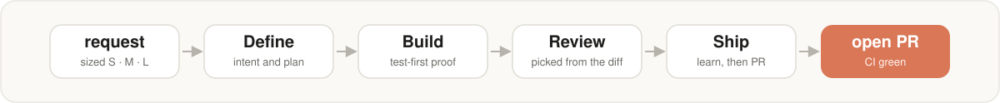
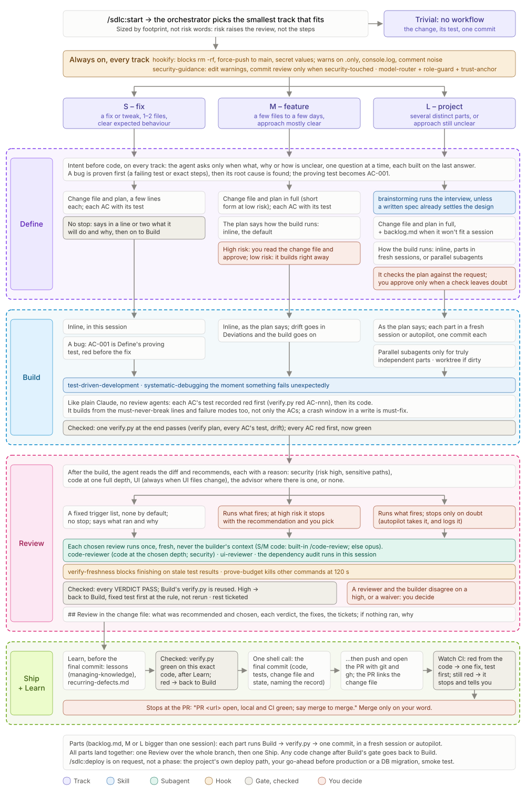

A Claude Code harness for your SDLC: work sized to fit, Define → Build → Review → Ship, test-first proof, diff-based reviews, and a record of every change.

You describe the work. sdlc decides how big it is, then takes it from intent to an open pull request. It asks you only at the decisions that matter. Everything it needs comes in one plugin.

## What you get

- **Work sized to fit.** A small fix runs straight through. A feature or a project gets a written plan first, and you approve it when the work is high-risk.
- **Four phases.** Define → Build → Review → Ship, the same on every change.
- **Test-first proof.** Each acceptance criterion has a test that fails before the code is written and passes after.
- **Reviews picked from the diff.** Security, code, UI or none, depending on what the change touched.
- **A record of every change.** Each change commits one file that says why it was made and how it was checked.
- **Guardrails.** Hooks warn or block in real time on secrets, focused tests and force-pushes to main.
- **Any stack, any repo shape.** Setup uses the commands your repo already runs, per package in a monorepo, and generates CI from them.

## Where to go

| You want to… | Read |
|---|---|
| Install it | [Install](Install.md), then [Quick start](Quick-start.md) |
| Understand how it works | [How it works](How-it-works.md): tracks, phases, hard stops |
| Know what to do in a situation | [Playbook](Playbook.md) |
| Look something up | [Commands](Commands.md), [Configuration](Configuration.md), [Where things live](Where-things-live.md), [Glossary](Glossary.md) |
| Fix something | [Health check](Health-check.md), [Troubleshooting](Troubleshooting.md) |
| Know why it's built this way | [Design decisions (ADRs)](../adr/README.md) |

Source, issues and releases: [github.com/tammai/sdlc](https://github.com/tammai/sdlc). Changes per version: [CHANGELOG](../../CHANGELOG.md).
