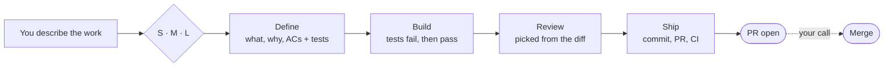

**sdlc** is a Claude Code plugin that takes your work from request to an open pull request: sized to fit, proven test-first, reviewed from the diff, and recorded.

## What you get

| | |
|---|---|
| **Sized to fit** | A small fix runs straight through. A feature or project gets a written plan first, and you approve it when the work is high-risk |
| **Same four phases** | Define → Build → Review → Ship, on every change |
| **Test-first proof** | Each acceptance criterion's test is recorded failing before the code and passing after |
| **Reviews from the diff** | Security, code, UI, or none, depending on what changed |
| **A record per change** | One committed file says why the change was made and how it was checked |
| **Guardrails** | Hooks warn or block in real time on secrets, focused tests, and force-pushes to main |
| **Any stack** | Uses the commands your repo already runs, per package in a monorepo, and generates CI from them |

## Where to go

| You want to… | Read |
|---|---|
| Install and try it | [Install](Install.md) → [Quick start](Quick-start.md) |
| Understand it | [How it works](How-it-works.md) |
| Know what to do in a situation | [Playbook](Playbook.md) |
| Look something up | [Commands](Commands.md) · [Configuration](Configuration.md) · [Where things live](Where-things-live.md) · [Glossary](Glossary.md) |
| Fix something | [Health check](Health-check.md) → [Troubleshooting](Troubleshooting.md) |
| Know why it's built this way | [Design decisions (ADRs)](../adr/README.md) |

Source, issues and releases: [github.com/tammai/sdlc](https://github.com/tammai/sdlc) · [CHANGELOG](../../CHANGELOG.md)
