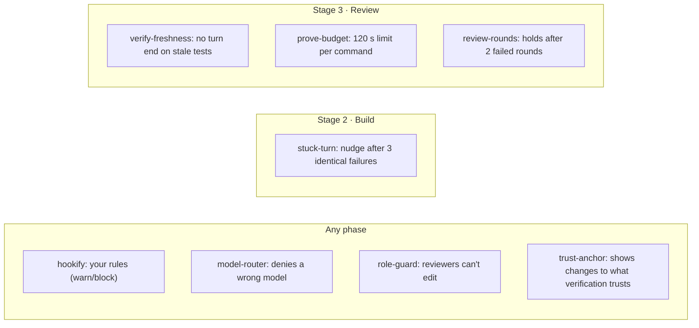

# Hooks

Hooks run automatically on Claude Code events. Most only warn. The ones that can **block** are shown below, by phase.

| Hook | Events | Does |
|---|---|---|
| **hookify** | PreToolUse, UserPromptSubmit, Stop | Runs rules from `.claude/hookify.*.local.md` (personal) and `.claude/hookify/*.md` (team); each rule warns or blocks. Started above sdlc repos or in a workbench: also applies each repo's rules there, and denies writes into a read-only repo (`write: false`), naming its owner. Spec-backed repo (`acceptance/manifest.json`): denies **everyone** any edit of a recorded acceptance test or the manifest, whether by an edit tool or a shell write (redirect, `tee`, `sed -i`, `cp`/`mv`, `rm`, `truncate`, `git checkout`/`restore`, PowerShell write cmdlets) |
| **security-guidance** | UserPromptSubmit, PostToolUse, Stop | Pattern warnings on edits. A model review at turn end and after `git commit`, but only while a security-touched feature is active (or with `SDLC_SECURITY_REVIEW=always`), and after `git push`. Build commits are batched with the next review-ready commit. A change that isn't security-touched is recorded as reviewed without a model call ([spec 05](../specs/05-security.md)) |
| **verify-freshness** | PostToolUse, PostToolUseFailure (Bash, PowerShell, edits), Stop | Stage 3: tracks whether tests are stale or fresh and blocks the turn end on stale. Stages 2–3: keeps its own copy of each `verify.py` run ([how](Verification.md#the-freshness-hook)) |
| **read-only-watch** | SessionStart, UserPromptSubmit, PreToolUse, PostToolUse, PostToolUseFailure, Stop | Workbench: keeps each read-only repo as sdlc first saw it (files, local commits, branch refs, push URLs). A difference is reported and blocks Stop, in later sessions too, until it's undone or you send `accept read-only <repo>`. A backstop behind role-guard |
| **prove-budget** | PreToolUse (Bash, PowerShell, Monitor) | Stage 3: wraps non-project commands in `timeout -k 5 120` (tool timeout 130 s). Quick reads (`git status`/`log`/`diff`/`show`/`branch`/`remote`, `tail`, `head`, `cat`, `wc`, `ls`) run unwrapped. Ship's one call (`ship.py` + `git commit` + `git push` + `gh pr create`) runs whole. Refuses what can't be wrapped (loops, subshells, two slow steps), plus `run_in_background`, Monitor and PowerShell for such commands. The project's own commands are untouched |
| **session-status** | SessionStart | In a repo with `.sdlc/`: one context line with setup state, drift, the feature's file paths, the remote, team rules and active features, so no `scaffold.py status` call is needed. Claude Code only |
| **model-router** | PreToolUse (Agent, Task) | While a feature is active: denies a dispatch with no model, with `haiku`, with Fable without `Top model: fable`, or a review agent below Opus. Logs each dispatch to `.sdlc/.work/dispatches.jsonl` ([R18](Troubleshooting.md#r18-a-subagent-dispatch-is-denied-by-the-model-router)) |
| **trust-anchor** | Stop, UserPromptSubmit, PostToolUse (AskUserQuestion) | Reports changes to what verification trusts, and blocks once until you accept ([what it reports](Shipping-and-gates.md#21-the-trust-anchor-stopped-me)). Changes that only add checks are shown without blocking |
| **review-rounds** | PreToolUse, UserPromptSubmit, PostToolUse (AskUserQuestion) | After 2 rounds whose latest verdict still fails (and isn't waived), denies every edit, command, subagent and skill except a reviewer's report and a test run, until you answer the `Review cap` question. Each answer allows one more round. It keeps the highest round seen, so deleting a report doesn't reset it |
| **stuck-turn** | PostToolUseFailure (Bash, PowerShell), UserPromptSubmit | Stage 2: when the same command fails the same way 3 times in one turn (digits ignored), adds one note telling the agent to stop retrying and use `sdlc:systematic-debugging`. Fires once per turn and never blocks. Silent outside Build, under the round cap, and for subagents. Claude Code only. The idea comes from microsoft/TokenEconomizer |
| **user-answer** | PreToolUse (AskUserQuestion) | While a feature is active: denies a question dialog with pre-filled answers and records the rest, so trust-anchor and review-rounds accept only real answers |
| **role-guard** | PreToolUse (file tools) | Reviewers (`sdlc-extras:` ones too) and code-explorer can't edit anything except their report under `.sdlc/.work/findings/`. qa-tester can't read or search code. Bash stays open. Above sdlc repos, each path is judged against its own repo |
| **SessionStart** | SessionStart | Creates the security reviewer's Python environment on first run ([R2](Troubleshooting.md#r2-first-session-is-slow-or-the-security-reviewer-is-unavailable)) |

**Python:** every hook finds Python through `bash hooks/sg-python.sh` (which skips the Microsoft Store stub), then starts that Python directly. `SDLC_HOOK_TIMES=1` logs each hook's time ([R10a](Troubleshooting.md#r10a-hooks-feel-slow)). `/sdlc:doctor`'s "hook python" check runs the launcher.

**Extras:** `sdlc-extras` adds the Ralph loop's Stop hook, active only while `/sdlc-extras:ralph-loop` runs.

**Other agents:** in Codex, Cursor and the Antigravity CLI, `hosts/hook.py` runs hookify, verify-freshness, read-only-watch, trust-anchor and review-rounds on that agent's events (in Codex, after you trust them in `/hooks`; [spec 11](../specs/11-multi-agent.md)).
