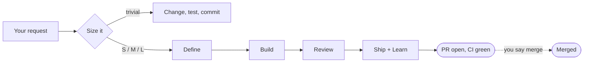
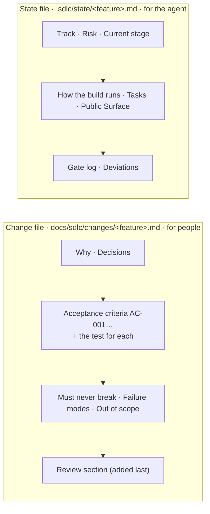
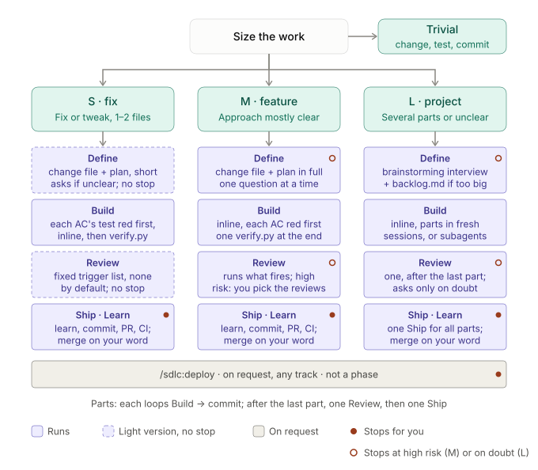
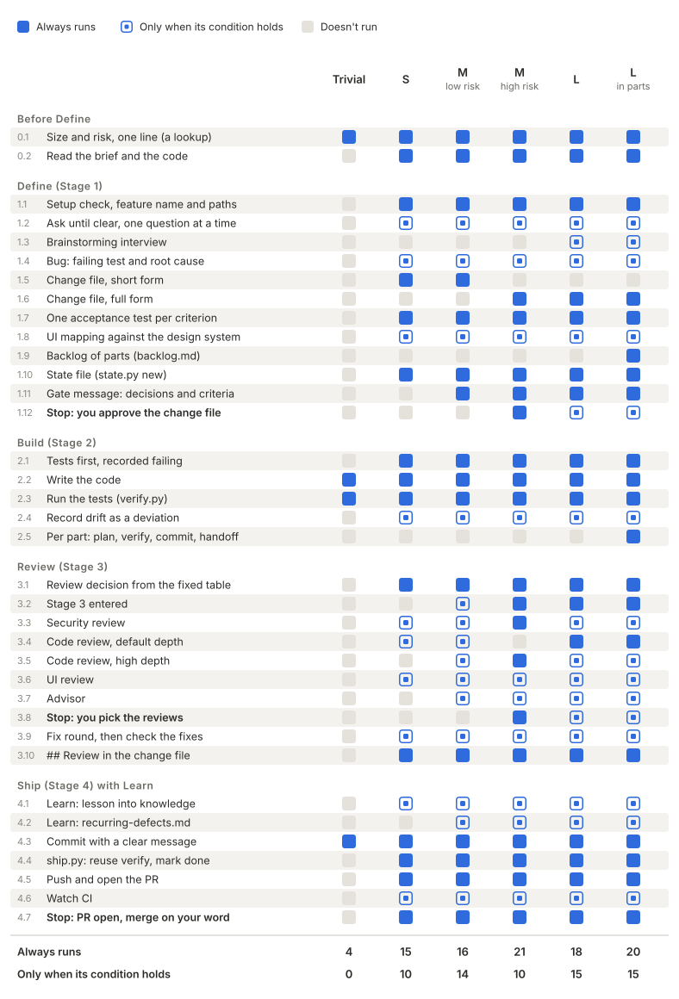
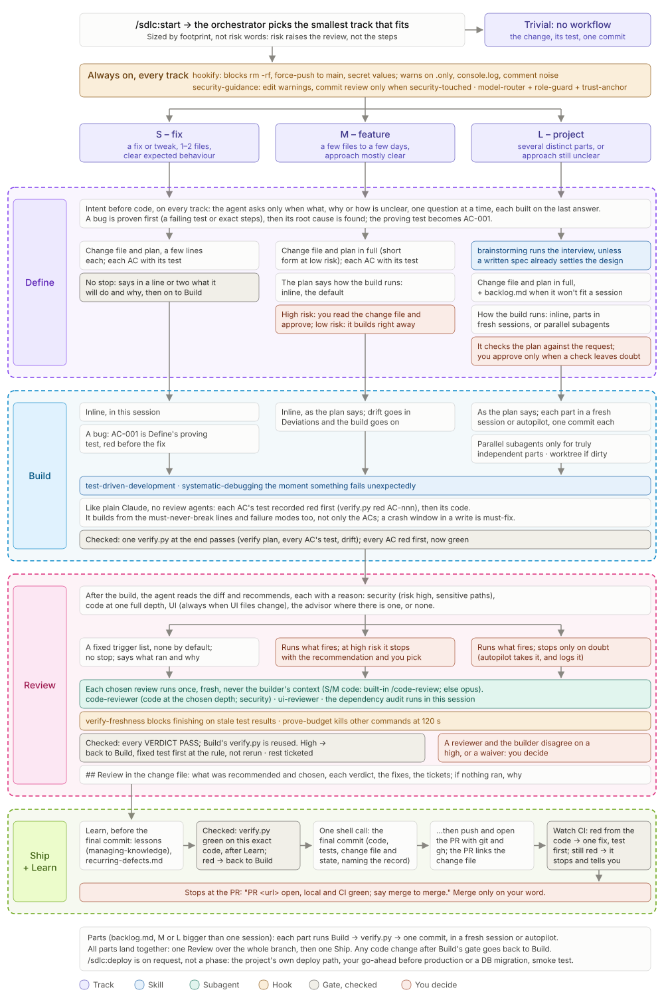
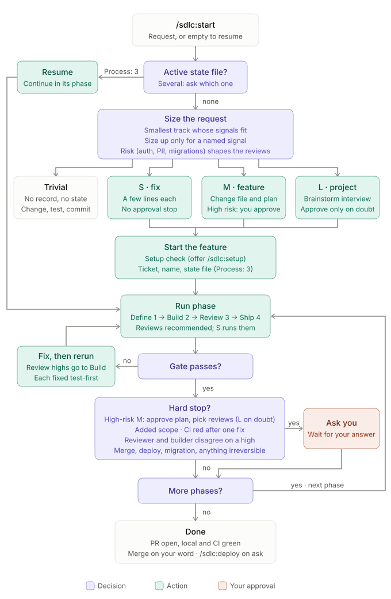

# How it works

sdlc takes one piece of work from request to an open PR. The **orchestrator** skill sizes it, runs four phases, records progress in two files, and stops at **gates** for your decisions.



## Four ideas

The goal is a trustworthy process (record, team consistency, easy review), not code better than plain Claude ([ADR 0020](../adr/0020-sdlc-2-slim-process-core.md)).

| Idea | In practice |
|---|---|
| **Intent before code** | What, why and how are written down first. Unclear? It asks, one question at a time. A bug is proven (failing test) and its root cause found first. |
| **Same record at every size** | Two files per change: the **change file** (for people) and the **state file** (for the agent). S writes a few lines; M and L write in full. |
| **Builder like plain Claude** | No review agents during Build. `verify.py` proves each acceptance test failed before its code and passes after. |
| **Reviews the change needs, once** | Picked from the actual diff, each run once by a fresh agent; high findings go back to Build. |

## The record



A later session, a reviewer or a teammate can pick up the work from these two files alone. Everything above `## Review` is frozen once Review starts, except the `## Definition of Done` checklist, ticked at Ship. Field-by-field layout: [Where things live](Where-things-live.md#statemd).

## Tracks

| Track | Use when | Before Build | After Build |
|---|---|---|---|
| **S · fix** | 1–2 files, clear expected behaviour | Record in a few lines; **no stop** | Fixed trigger list (usually no review); tells you what ran |
| **M · feature** | A few files to a few days, approach mostly clear | Record in full. **High risk:** you approve. Low risk: builds straight on | Triggered reviews run. **High risk:** you pick them |
| **L · project** | Several parts, or approach unclear | Same, interview via `brainstorming`. You approve **only if its own checks leave a doubt** | Triggered reviews run; asks only on doubt |

- **Size** = footprint (files touched). The agent proposes the smallest fitting track and sizes up only for a named signal. You can override anytime.
- **Risk** is separate from size. `Risk: high` = auth, payments, secrets, PII, schema migrations, a breaking public-API change, or untrusted input reaching a shell, file path or database. Adding a command, flag or field is `low`.
- **Security-touched** = `Risk: high`, or the diff hits `areas.sensitive` / `areas.migrations` in `.sdlc/config.json`. It triggers a security review and a model review on commit.
- **Models:** the build runs on your session's model. Every review runs on `opus` (the model router enforces it). Other subagents run on `sonnet` with `effort: high`. `haiku` is never used. Fable is used only if you ask for it (`Top model: fable`).



Which step runs on which track (also as text: [track-matrix.md](../track-matrix.md)):



## The four phases

| Phase (stage) | Produces | Gate to leave |
|---|---|---|
| **Define** (1) | Change file up to `## Review`, state file plan (+ `backlog.md` if split) | S: none. M/L: your approval where the track says. Every AC has a test row, out of scope is filled |
| **Build** (2) | Code, tests, red records, a passing `verify.py` | Every task done; every AC test recorded red then passing; drift recorded as deviations |
| **Review** (3) | `## Review` in the change file | `verify.py` passes on current code; every chosen review's verdict is `PASS` or its highs are fixed or waived. If security-touched: no critical/high finding, no secrets |
| **Ship** (4) | Learn notes, commit, push, PR | Learn done, green locally and on CI, PR open. **Never merged without you** |

Each track phase by phase, with its skills, subagents, hooks and gates:



Stage numbers matter because the hooks read them (`Current: Stage 3 – Review`). Deploy is not a phase. It runs only when you ask: [`/sdlc:deploy`](Shipping-and-gates.md#10-merge-and-deploy).

**Define.** One call (`scripts/brief.py`) reads config, baseline, knowledge, recurring defects, constitution and PRD. If the request, ticket, code and `knowledge/` already settle what, why and how, it writes the files and goes on. Otherwise it asks, one question at a time, until nothing that matters is a guess. Anything it would add that you didn't ask for is listed as a proposal and dropped unless you keep it. Your own rules for the record go in `.sdlc/config.json` → `rules` (`change`, `plan`, `review`).

**Build.** It writes every AC test, records them failing in one call (`verify.py red AC-001 AC-002 …`), writes the code, then runs `verify.py` once. It writes against the spec's must-never-break lines, failure modes and the recurring-defects list. Going off-plan never stops the build: each change is one `state.py deviation` line ("What: … Why: … Effect: …"). How the build runs is decided in Define: **inline** (default), **parts in fresh sessions**, or **parallel subagents** for truly independent parts.

**Review.** See [Review](Review.md).

**Ship.** First **Learn**: a lesson goes into knowledge only if it isn't obvious from the code or commit, and each fixed high finding gets a line in `recurring-defects.md`. Then a green `verify.py`, then one shell call that commits code, tests and both record files, pushes, and opens the PR. CI red because of the code gets one test-first fix. If it's still red, or red for a CI-only reason, the agent tells you. Without a remote it stops with the branch ready.

Each phase opens with a header:

```
▶ <Phase>   (track M, risk low)
  Gate: <exit criterion>
```

## Hard stops

The agent **always** asks you, using a question dialog (never a line you might scroll past), before:

- Building a high-risk M (and L when in doubt): approving the record
- Choosing reviews on a high-risk M (and L when in doubt)
- Anything that adds scope
- A reviewer and the builder disagreeing on a high finding
- CI still red after one fix
- Merge, production deploy, DB migration, or anything irreversible

The whole loop, with its hard stops:



Everything else runs on its own; interrupt anytime. Say "skip" or "just ship it" and it names the skipped steps, records them as deviations, then complies ([9](Shipping-and-gates.md#9-skip-a-gate-deliberately)). Who owns each decision: [Who decides what](Shipping-and-gates.md#who-decides-what).

## Big work: parts and autopilot

M or L work too big for one session gets a `backlog.md` of **parts** (B1, B2, …), approved with Define. Each part is planned, built, verified and committed. After the last one, **feature close** runs one Review over the whole branch, then Ship. Autopilot runs the remaining parts without stopping. Details: [Big work and autopilot](Big-work-and-autopilot.md).

## Optional features

| Feature | Turn on | What it does |
|---|---|---|
| **Living spec** | `"living_spec": true` | Each change adds `## Capabilities` (`add`, `replace`, `remove`, `retire`, or `none: <why>`). Ship merges it into one file per capability under `docs/sdlc/capabilities/`, each requirement linked to its test and change. `ship.py` refuses a section it can't apply |
| **Domain model** | `/sdlc:setup objects` (sets `"objects": true`) | `docs/sdlc/objects.md` lists each object's UI and code name, states, actions, rules (`DR-001`…) and names to avoid. Define uses its names. Adding or renaming an object asks you first. `objects.py check` gates it, and Review checks the `DR` rules |
| **Code graph** | have `graphify-out/graph.json` | Define queries it for the files a request touches. Rebuilding it never counts as a code change |

A spec-backed repo (built from an rspec spec) uses the spec instead of the living spec, and its `domain.md` instead of `objects.md`.
