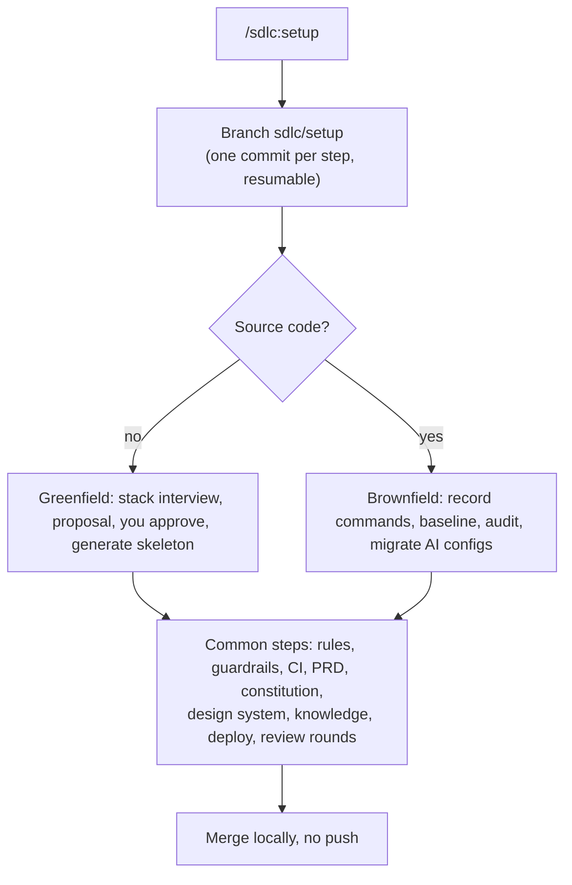
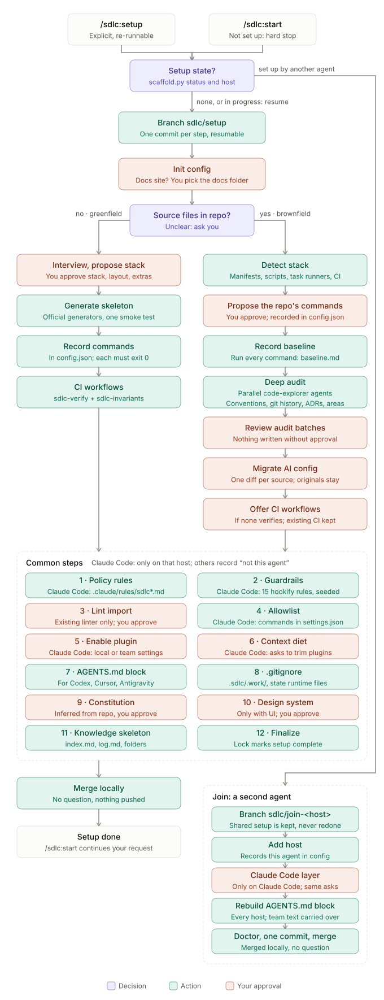
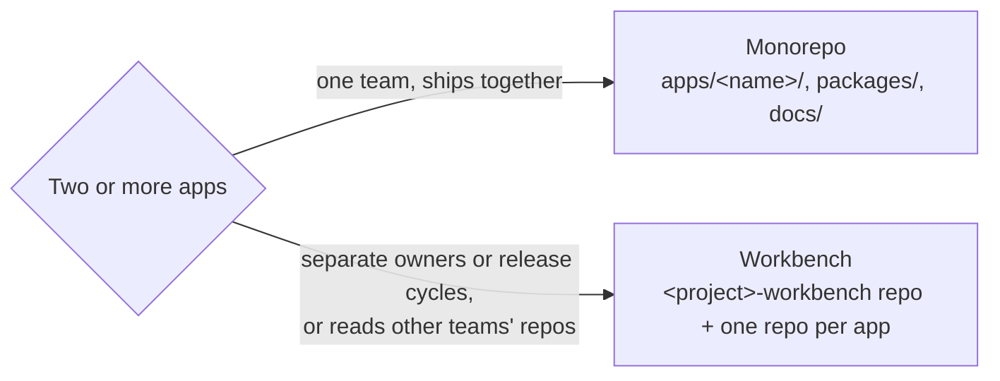
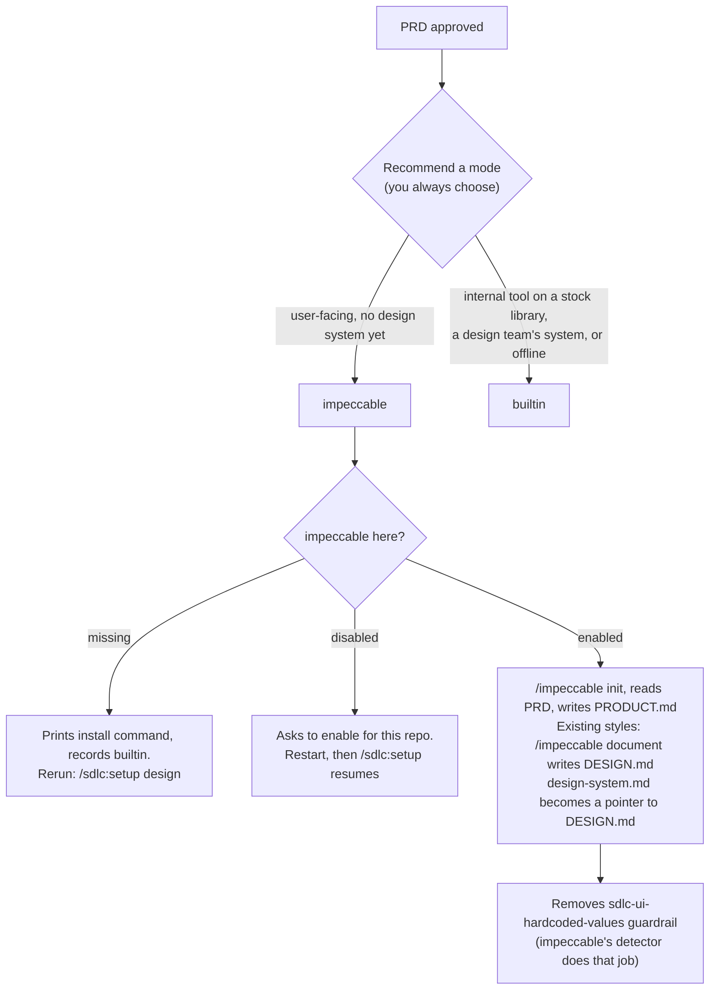

# Project setup

`/sdlc:setup` prepares a repo once, before the first feature. `/sdlc:start` offers it if the repo isn't set up. Step-by-step plays: [Setup and upgrade](Setup-and-upgrade.md).

## Principles

- **Your commands, not ours.** Setup records the repo's own `install`, `test`, `lint`, `typecheck` and `build` commands in `.sdlc/config.json`, exactly as the team runs them (`pnpm test`, `go test ./...`, `make lint`). A missing step is `null`. Nothing in the plugin is stack-specific. A monorepo lists `packages`, each with its own path, stack and commands.
- **No tooling you didn't ask for.** Setup never changes your manifest or dependencies: no new fields (`bin`, `engines`, `packageManager`, scripts), no new linter, formatter or devDependency, and no install without asking.

## Greenfield, brownfield, multi-app

| Mode | What setup does |
|---|---|
| **Greenfield** (no source) | Short stack interview, then a proposal you approve. Starts from preferred stacks (Nuxt, Vue, React, Next.js, Flutter, native iOS/Android, Node + Hono, Go + Gin, Python + FastAPI; `skills/setting-up-projects/references/stacks.md`). Three extra answers pick the shape: does anything outside call the API, the heaviest workload, and first-year scale ([ADR 0026](../adr/0026-stack-blueprints-in-setup.md)). The ecosystem's own generator builds the skeleton, a test runner and one passing smoke test. A linter and toolchain pinning are opt-in. Stack rules (`.claude/rules/<stack>-<area>.md`) are written later, by the first feature that touches each area |
| **Brownfield** (existing code) | Shows the detected commands before writing them. Records a **baseline** of what already fails. Explorer agents draft an audit (conventions, git-history gotchas, decisions, area rules), and each batch is written only after you approve it. Existing AI configs (CLAUDE.md, AGENTS.md, Cursor rules, ADRs) are migrated into the [three knowledge tiers](Where-things-live.md#three-tier-knowledge), one diff per source |
| **Two or more apps** (greenfield) | Setup asks which layout. See below |

### Monorepo or workbench

| | Monorepo ([ADR 0005](../adr/0005-greenfield-monorepo-layout.md)) | Workbench ([ADR 0025](../adr/0025-workbench-for-multi-app-projects.md)) |
|---|---|---|
| Holds | Every app in one repo | `workbench.json`, the API contract (`contract/v1/openapi.yaml`), shared docs, and **all feature records**. Each app is its own repo cloned inside (gitignored), with its own commands, CI and guardrails |
| Other teams' repos | n/a | Cloned **read-only**: sdlc denies writes and names the owner |
| A feature | One branch, one PR | One branch and PR per repo touched. `ship.py` lists them in merge order (workbench → provider → consumers), and `ship.py <feature> --status` warns about out-of-order merges |
| CI | Per app if roles differ | A consumer's CI checks out the workbench branch named like its PR's (else `main`). A private workbench needs a `WORKBENCH_TOKEN` secret |
| Change later | n/a | `scaffold.py workbench add <url>` / `remove <name>` |

Existing monorepos keep their layout.

## Common steps (both modes)

| Step | Notes |
|---|---|
| Policy rules, hookify guardrails | `.claude/rules/sdlc*.md`, `.claude/hookify/sdlc-*.md` |
| Lint snippets | Only for a linter the project already has |
| Permission allowlist | For the project's commands |
| Turn plugins on | Asks where: `.claude/settings.local.json` (this machine only) or `.claude/settings.json` (committed, teammates get it; [cloud sessions](Cloud-sessions.md) don't). Companions `sdlc-extras` and `sdlc-stepper` are on by default. It names the optional `security-audit` skill with its install command but never runs it. Conflicting plugins (such as superpowers) are turned off for this repo only, with a warning; spec-kit files are reported, and removal is asked |
| Context diet | With your approval ([13](Rules-and-context.md#13-keep-always-loaded-context-small)) |
| CI workflow | Generated from the recorded commands. Asks first if CI already exists |
| `AGENTS.md` block | When Codex, Cursor or Antigravity uses the repo |
| PRD | Your existing one, or drafted from an interview or the code. Guesses are marked "inferred, confirm". You approve before it's written to `docs/sdlc/prd.md` |
| Constitution | The default Simplicity principle plus architecture principles for your stack |
| Design system | UI projects only ([with impeccable](#setup-with-impeccable)) |
| Knowledge folder | Greenfield: includes a scaling roadmap (growth steps and the trigger for each) |
| Deploy | Asks for the target (for example GCP Cloud Run) and each environment, routine or not. Seeds `knowledge/runbooks/deploy.md` |
| Review rounds | Asks how many review rounds (2 to 5) run before you're asked; stored as `review_rounds` |

The steps that write `.claude/` run only under Claude Code.

## Who owns which file

Everything the plugin places is tracked in `.sdlc/scaffold.lock.json`. The class decides what an upgrade may do:

| Class | Examples | On upgrade |
|---|---|---|
| **Generated** | `.claude/rules/sdlc*.md` | Regenerated |
| **Seeded** | `.claude/hookify/sdlc-*.md`, `.github/workflows/sdlc-verify.yml`, `sdlc-invariants.yml`, `.sdlc/ci/invariants.py`, `.sdlc/lint/*` | Replaced only if unedited. Edited: you choose merge, skip, or keep yours for good |
| **Keyed merge** | Allowlist and plugin keys in `.claude/settings*.json`, `.gitignore` lines, the `<!-- sdlc:begin -->` block in `AGENTS.md` | Only the plugin's own entries; your surrounding text is never touched |
| **Yours** | Commands in `.sdlc/config.json`, `CLAUDE.md`, PRD, constitution, design system, `knowledge/`, baseline, your rules | Changed only by migrations you approve |

**Rule of thumb:** files named `sdlc-*` belong to the plugin; everything else is yours.

**Upgrades.** When the plugin is newer than the scaffold, `/sdlc:start` and `/sdlc:status` suggest `/sdlc:upgrade`. It never blocks your work. See [16](Setup-and-upgrade.md#16-upgrade-after-a-plugin-update). `/sdlc:eject` removes what the plugin owns and keeps your work.

## Setup with impeccable

A UI project can hand design work to the [impeccable](https://github.com/pbakaus/impeccable) skill, while sdlc keeps the record, the gates and the review verdict ([ADR 0021](../adr/0021-impeccable-for-ui-design.md)). The choice is made in setup's `design-system` step and stored as `"design": "builtin" | "impeccable"` (no key means builtin).

The recommendation also notes impeccable.style's network call and the telemetry opt-outs. sdlc never installs impeccable for you.

| File | Owner | Holds |
|---|---|---|
| `docs/sdlc/prd.md` | you | Product source of truth (wins over PRODUCT.md) |
| `PRODUCT.md` | impeccable | Design-relevant part, linking back to the PRD |
| `DESIGN.md` | impeccable | The design system, once a visual world exists (a system you must stay on is documented as pinned) |
| `docs/sdlc/design-system.md` | you | Pointer to `DESIGN.md` |

**Each UI change in impeccable mode:**

| Phase | What happens |
|---|---|
| Define | `/impeccable shape`; you confirm the brief, which is copied into `## UI mapping` and the ACs |
| Build | Built through impeccable; its detector hook reports after UI edits |
| Review | `ui-reviewer` (opus) runs impeccable's `detect`, applies its `audit` checks as evidence, and writes the verdict. A missing `DESIGN.md` is Medium, not High |

If impeccable is missing or turned off when a step runs, the step says so and runs builtin, and `/sdlc:doctor` warns. To switch modes later, run `/sdlc:setup design`. Switching adds or removes the UI guardrail.
