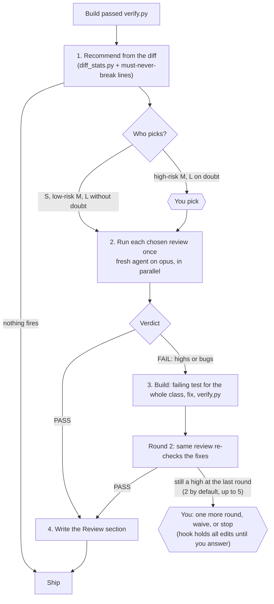

# Review

Review starts from Build's passing `verify.py`. It doesn't rerun that unless the code changed.

## 1. Recommend

The agent reads what actually changed (sensitive or migration paths, public interfaces, persisted data, UI files, size). The triggers are fixed facts, not the agent's judgment:

| Review | Fires when |
|---|---|
| **Security** | Security-touched (`Risk: high`, or the diff hits `areas.sensitive` / `areas.migrations`), or untrusted input reaches a shell, file path or database |
| **Code** | A declared Public Surface, a large diff (> 5 source files or > 300 added lines), L, `Risk: high`, or the spec names a crash mid-write or concurrent use as a failure mode |
| **UI** | The diff touches `areas.ui` (always) |
| **Advisor** | Only where the agent has one, for a judgment call the reviews can't settle |

- **S** uses a fixed list: security on `Risk: high`, `areas.sensitive` or `areas.migrations`; UI on `areas.ui`; code when Public Surface isn't `- none`; otherwise none.
- **Nothing fires** (for example a low-risk M where every AC was seen failing, then passing): no review, straight to Ship.
- The code review has **one depth, the full one**. A lighter first round would only push findings into later rounds.
- A `manual` AC is checked by whichever review runs, or by the session if none does.

## 2. Run each review once

Each review is a **fresh agent on `opus`**, never the context that wrote the code. All chosen reviews are dispatched together, and each writes a report to `.sdlc/.work/findings/<feature>/` ending in `VERDICT: PASS` or `VERDICT: FAIL — <ids>`.

| Review | Who runs it |
|---|---|
| Code (S, M in Claude Code) | Built-in `/code-review` (`high --max-findings all`). The agent rates the findings, and `scripts/review_report.py` writes the report and computes the verdict |
| Code (L, and Codex / Cursor / Antigravity) | `code-reviewer` with the shared brief: every AC and must-never-break line, silent failures, test gaps rated 1–10 (8+ is high), simplifications, security basics, each failure mode traced |
| Security | `code-reviewer` with the security-only brief, plus a dependency audit and the security hooks' session findings |
| UI | `ui-reviewer` with `design-system.md`, the spec and the diff |

Round 1 reports **every** finding, with no length limit: its root cause, every place it shows, and what the fix must keep working. Unsure findings are marked `unconfirmed` and never fail the round.

## 3. Act on findings

| Finding | What happens |
|---|---|
| **High**, or a **bug** in touched code | Back to Build: a failing test that covers the **whole class** of the finding, then the fix, then `verify.py`. An open-ended class (encodings, input shapes, env vars) gets a structural fix: one shared check, an allowlist, fail closed |
| `unconfirmed` | Gets a test. Fixed if the test fails, dropped if it passes |
| Medium/low that breaks an AC, a must-never-break line, the linked spec or a constitution rule | Treated as **high**. The agent may raise a severity, never lower it |
| Anything else (improvements, untouched code) | A ticket in the change file's `## Review` |

**Round 2** is meant to be the last. The failed review runs again at full depth on the fixes and the code around them, to confirm each finding is gone everywhere and that no fix added a bug. From round 2 on, **only a high fails**. A medium or low bug it finds is fixed test-first and closed by `verify.py`, without another round.

**Round cap.** If round 2 (or the last round `review_rounds` allows, 2 to 5) still fails on a high, you decide: one more round, a waiver, or stop. The `review-rounds` hook holds every edit and command until you answer, and each answer allows one more round. To allow more rounds, type `/sdlc:setup review-rounds <n>` ([R20](Troubleshooting.md#r20-every-edit-and-command-is-denied-after-a-review)). If the agent thinks a high is wrong, it brings you its case. **Only you can waive.**

## 4. Record

`## Review` is written once, as the change file's last section: what was recommended and why, what was chosen and by whom, each verdict, the highs with their fixes, the tickets, drift, and `manual` ACs. Everything above it stays as Define wrote it. The end-of-Review message lists every deviation and `manual` AC, so you see them without opening files.

The [trust anchor](Shipping-and-gates.md#21-the-trust-anchor-stopped-me) gives a notice if a feature leaves Review without a passing full run of the current code, or with an unwaived `VERDICT: FAIL`.

You can ask for a **QA round** (`qa-tester`) anytime; you decide what its failures mean.
