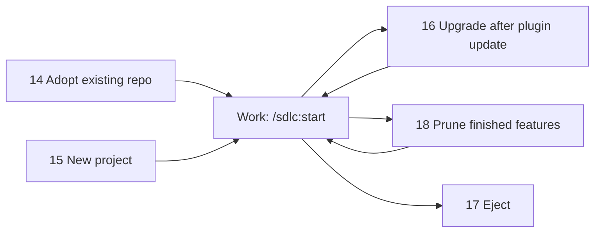
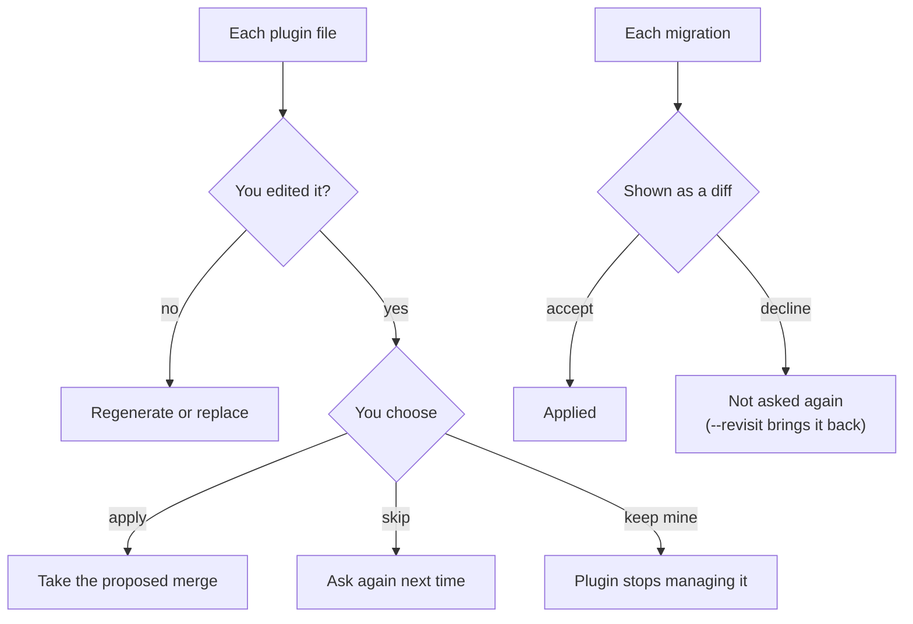

# Setup and upgrade

The repo lifecycle: adopt or create → upgrade when the plugin updates → clean up → (optionally) remove. Concepts behind it: [Project setup](Project-setup.md).

Every one of these runs on its own branch and **merges locally without asking. Nothing is pushed.**

## 14. Adopt sdlc in an existing repo

1. [Install](Install.md) the plugin. Commit or stash your work.
2. `/sdlc:setup`: detects brownfield and works on `sdlc/setup`, one commit per step.

| Step | What you do |
|---|---|
| **Commands** (`pnpm test`, `make lint`, `./gradlew build`…) recorded in `.sdlc/config.json`, per package. Manifest and tooling untouched | Approve the list |
| **Baseline**: runs them and records what already fails in `.sdlc/baseline.md`. Features are judged only on **new** failures. A failing install or build stops setup | — |
| **Audit**: explorer agents draft conventions, git-history gotchas, decisions, area rules | Approve, edit or drop each item |
| **Existing AI config** (CLAUDE.md, AGENTS.md, Cursor rules, ADRs): one migration diff per source. Originals stay unless you say delete | Approve each diff |
| **The rest**: rules, guardrails, lint snippets, allowlist, PRD, constitution, design system (UI only), knowledge, plugin enablement, context diet, deploy ([details](Project-setup.md#common-steps-both-modes)). Existing CI is left alone, with differing steps pointed out; a repo without CI is offered a workflow, and every repo the `sdlc-invariants` check | Answer each question |

3. Try the loop end to end with a small S fix: `/sdlc:start …`.

Interrupted? Run `/sdlc:setup` again; it resumes. Want one name per thing across changes? Run `/sdlc:setup objects` afterwards ([domain model](How-it-works.md#optional-features)).

## 15. Start a new project

1. Create an empty repo (a README and LICENSE are fine), then run `/sdlc:setup what you're building`.
2. Answer a few stack questions. It proposes the stack, layout, generator and commands, plus optional extras (linter, formatter, toolchain pinning), all **off unless you say yes**. **You approve before anything is generated.** No auth, database or infra "for later" unless you asked for it.
3. The ecosystem's generators build the skeleton with strict types, a test runner and one passing test per package. Every command must pass.
4. CI: `.github/workflows/sdlc-verify.yml` from the same commands, plus `sdlc-invariants.yml`. Windows teammates: set `"ci": {"os": ["ubuntu-latest", "windows-latest"]}`.
5. The common steps as in [14](#14-adopt-sdlc-in-an-existing-repo), with no baseline. Then `/sdlc:start` your first feature.

**Several apps** (web, API, mobile) in one monorepo: `apps/<name>/`, `packages/` for shared code, `docs/` for BA/QA/design files, and `infras/` only if you say yes. Setup asks who works in the repo:

| Team | Gets |
|---|---|
| Separate roles | CODEOWNERS, one CI workflow per app, release runbook `docs/runbooks/releasing.md` |
| Solo or small team | One workflow |

When one app serves an API another app uses, the contract goes in `packages/api-contract/v1/`, and (if you agree) CI blocks breaking changes to published versions. Details: `skills/setting-up-projects/references/monorepo.md`. For separate repos per app, see [workbench](Project-setup.md#monorepo-or-workbench).

## 16. Upgrade after a plugin update

`/sdlc:start` and `/sdlc:status` tell you when the scaffold is behind the plugin. Waiting breaks nothing; you just miss new rules and fixes.

1. Finish or pause in-flight features if you can.
2. `/sdlc:upgrade --dry-run` shows the plan: files added, regenerated, replaced, edited by you, deleted by you, no longer shipped, and migrations.
3. `/sdlc:upgrade` runs on `sdlc/upgrade-<from>-<to>`:

- A new CI workflow is asked about first.
- An edited guardrail (`.claude/hookify/sdlc-*.md`) **you apply yourself**: Claude is blocked from editing the rules that constrain it.
- Afterwards the repo records a minimum plugin version, so teammates on an older plugin are told to update.

## 17. Remove sdlc from a repo

`/sdlc:eject` shows a dry run first, then works on `sdlc/eject`.

| Removed (the plugin's) | Kept (yours) |
|---|---|
| Generated rules, unedited guardrails, CI workflow, lint snippets, allowlist, plugin-enablement and `.gitignore` entries it added, the `AGENTS.md` block, the lock | `.sdlc/config.json`, PRD, constitution, design system, knowledge, baseline, area rules, every feature's change file and state |

Edited plugin files are asked about one by one. It fixes imports that pointed at deleted files and runs the verify commands. Afterwards, `/plugin uninstall sdlc` if you're done.

## 18. Clean up finished features

Old plans and reports describe code that has since changed, and they can mislead agents searching the repo.

1. `/sdlc:prune` lists features marked done on the main branch 45+ days ago (change with `--older-than 90d`), with the files it would delete: `plan-B<n>.md` and `qa-report.md`.
2. Pick which to prune. **The change file and the state file always stay.**
3. It commits the deletions in one commit; git history keeps everything.
