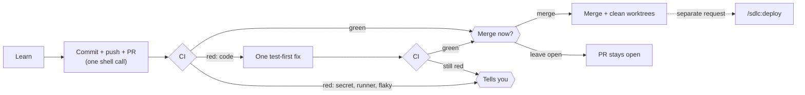
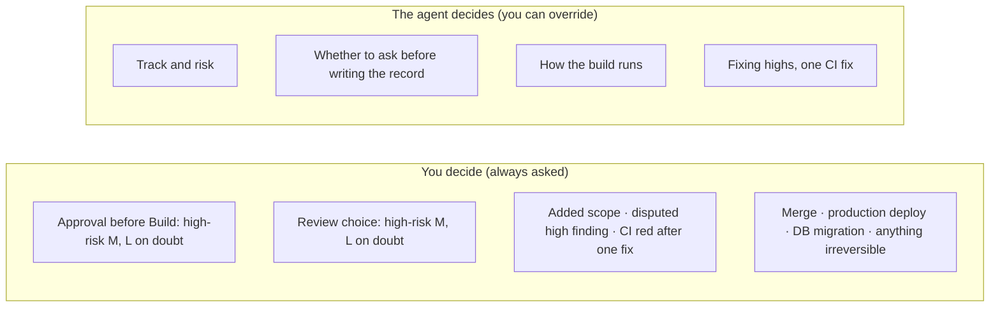

# Shipping and gates

## 9. Skip a gate deliberately

Say `skip` or `just ship it`. The agent names the gates it's skipping, records them as a deviation in the state file, then complies.

**Skipping is allowed; skipping silently is not.** Hard stops (merge, production deploy, migrations, anything irreversible) still wait for your explicit word.

## 10. Merge and deploy



1. **Ship** commits code, tests and both record files on a feature branch, pushes, and opens a PR that links the change file. Without a remote, it stops with the branch ready.
2. **It stops at the PR**, with `PR <url> open, local and CI green.` and a **Merge now?** dialog. **The agent never merges without you.** On merge, the `finishing-a-development-branch.md` reference merges and cleans up worktrees. `/sdlc:clean-gone` prunes merged local branches when you ask.
3. **Deploy** is a separate request: `/sdlc:deploy [feature] [environment]`.

| Deploy step | Behaviour |
|---|---|
| Feature not shipped yet | Warns; continues only on your word |
| Deploy path | Uses the project's own (scripts, a CI job, the platform CLI). If there's none, it says so and stops |
| Production or a migration | Shows the environment, version, steps, migration and rollback command, then **waits for your yes**. A routine staging deploy doesn't wait |
| Smoke test | Always runs. On failure it offers rollback; a production rollback needs another yes |
| Record | Writes `release.md` in the work folder (version, environment, steps, smoke result, rollback). Commits it only if you ask |

## 21. The trust anchor stopped me

The agent can write the files that verification trusts (state, change file, baseline, config), so the trust anchor **shows you** every change to them. The turn stops once with:

```
⚠ Verification anchors changed: … Your answer accepts it.
```

The agent explains what changed and why, then asks in a `Trust anchor` dialog. It doesn't undo anything on its own.

| Reported (per current feature, `Process: 3`) | Blocks? |
|---|---|
| `Track:` up, or `Risk:` low → high ("Stricter process: …") | No |
| `Track:` down, `Risk:` high → low, or `Top model:`, `Base:`, `Process:` changed | Once |
| A failing test added to `.sdlc/baseline.md`, or commands in `.sdlc/config.json` changed since `Base:` | Once |
| Change file edited above `## Review` (criteria, tests) after Review started | Once |
| Leaving Review without a passing full run of the current code, or with code changed since that run | Once |
| Leaving Review while a review's latest report says `VERDICT: FAIL`, unless a `waived round <N>` deviation covers it | Once |
| `verify records disagree`: `verify.json` differs from the hook's copy, or is missing/damaged | Once |
| A feature stops being active other than by finishing (paused, state file deleted) | Once |
| The trust anchor's own record is damaged | Once |

**What to do:** read it. If the change is right, carry on; your next message accepts it. If not, say so and have it put back ([R19](Troubleshooting.md#r19-a-trust-anchor-notice-stops-the-turn)).

**Autopilot** won't start a session while a notice is open; its JSON `stopped` reason quotes the notice. Send any message in a normal session to accept it, then rerun.

## Who decides what



**Also yours** (not a stop, but only you can do it):

| Decision | How |
|---|---|
| Running setup, the stack, the recorded commands | You approve |
| Each audit batch, each AI-config migration | Approve, edit or drop |
| Upgrade: edited plugin files, new workflows, migrations | Per file / per migration |
| Adding a failure to the baseline | Recorded as a deviation |
| Waiving a high finding | Recorded as a deviation |
| Skipping a gate | Recorded as a deviation |
| Design-system changes a reviewer proposes | You decide |
| Accepting a trust-anchor notice | Your answer to its dialog, or your next message |

**The agent's calls:**

| Decision | Rule |
|---|---|
| Track and risk | Proposed; you can override |
| Ask before writing the record? | Asks when what, why or how is unclear |
| How the build runs (inline, parts, parallel) | Written in the state file; shown at the approval when there is one |
| Reviews on S | Fixed trigger list (`s-track.md` step 5); none unless one fires |
| Reviews on low-risk M, L without doubt, autopilot, headless | The triggered reviews / the recommendation, logged |
| Verify verdict | The latest `verify.py` run on the current code |
| Fixing high findings, and one CI fix | Without asking |
