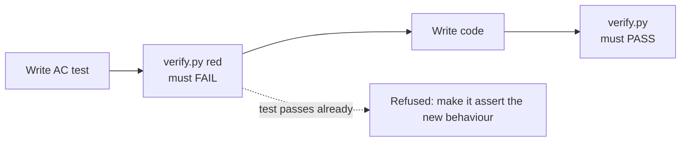
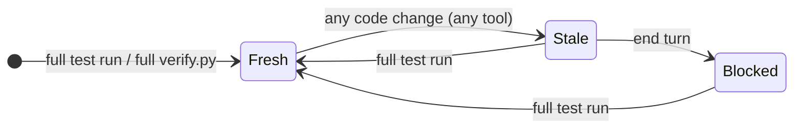

# Scope and verification

Two questions, checked by machine where possible: **did it build only what was asked?** (scope) and **is it proven to work?** (verification).

## Scope tracing

Every addition must trace back to the request.

| Where | Check |
|---|---|
| **Define** | Adds no hardening, options, config or tooling that the request or a failure mode doesn't call for. Anything extra is listed as a proposal and dropped unless you keep it |
| **Change file** | Every AC has a test that can prove it, and there's an out-of-scope section |
| **State file** | Each task names its files. **Public Surface** declares every new export, endpoint, command, config key, env var and dependency |
| **`verify.py`** | A changed file that no task names is **drift** until a deviation line covers it |
| **Review** | `scripts/diff_stats.py --plan` flags exports and dependencies missing from Public Surface. Undeclared public surface is a **high** finding. Every reviewer also checks the failure modes and the recurring-defects list |

## Verification

### `verify.py`

Build's single command. Three modes:

| Command | Does |
|---|---|
| `verify.py red AC-001 AC-002 …` | Records each AC test **failing** before its code. If any test passes, can't be found or can't run, the whole batch is refused |
| `verify.py` | Full run: the project's verify plan (lint, typecheck, build, Storybook when set, full suite), every AC's test, and the drift check. Prints the head and tree that `state.py verified` takes |
| `verify.py status` | Short JSON. `reuse: true` when the last run passed, both records agree and the code hasn't changed, so Review and Ship skip a rerun |

- An AC whose command exits 0 after running no tests (`Ran 0 tests`, `no tests ran`) fails as **not run**.
- **Test lock** (M, L, S with config `guards.s_tests`, and every track in a spec-backed repo): `verify.py red` stores each test file's hash under `## Test lock`. A locked test that later changes or is deleted fails the run unless a `test-change <file> What: … Why: …` deviation names it and `verify.py red --at <Base> <ACs>` shows it still fails on Base. S without that guard locks nothing.
- **`verify.py trace`**: when ACs cite a written spec (`AC-003 … prd.md §4.2`), it reports cited sections the spec lacks and any `FR-nnn` that no AC names and `## Out of scope` doesn't set aside. L's self-approval runs it, and a full run prints the same findings as advisory `trace:` notes.
- **`--json`**: `verify.py`, `ship.py` and `.sdlc/ci/invariants.py` print one JSON document: a `result`, plus each problem as `{severity, code, message, target, fix}`. Codes are stable (`red_not_recorded`, `test_lock_changed`, …). The plain output and exit codes don't change.

Spec-backed mode (repos built with rspec / product-rebuild)

Applies only in a repo with an rspec `criteria.lock.json` (or `spec_lock` in `.sdlc/config.json`) or `acceptance/manifest.json`.

- An AC may cite a locked criterion: `- **AC-003** → F-ISS-01.AC2`. Every run fails on:
  - an ID the lock doesn't hold,
  - an ID that `state.py cite` didn't record at Define,
  - a slice criterion (`state.py new … --criteria`) that no AC cites and `## Out of scope` doesn't set aside,
  - a `stale criterion` the spec changed since Define.
- An AC whose test is an `open` recorded test runs against the build that `verify.py` starts from `accept.start` at `accept.base_url`. hookify keeps those test files read-only.
- If a decided departure (`docs/departures.yaml`) says a recorded test can't pass, a row `| AC-003 | departure D-004 | <path> |` sets that test aside, next to a builder test row for the same AC. Every run checks that the departure is decided and covers that criterion.
- A question about a cited criterion goes through `state.py question`, which blocks the part until the lock shows the criterion amended.

### The freshness hook

While the state file says `Current: Stage 3 – Review`, this is the only hook that can block you:

- **Full run** = the `test` command from `.sdlc/config.json` with no extra arguments. A run that names a test file, a pytest node id, a single Go package or a name filter doesn't count.
- **Monorepo:** freshness is tracked per package. An edit under `services/api/` makes only `api` stale; `cd services/api && <api's test command>` makes it fresh again. A file outside every package makes all packages stale. A root test command (for example `turbo run test`) counts for every package.
- Docs and anything under `.sdlc/`, `knowledge/`, `.claude/` or `docs/` never make results stale.

How verify runs are recorded

`verify.py` writes the hook's copy of each run (each AC's red record, a full run's tree and result) beside `.sdlc/.work/verify.json`, so the run counts however the command was spelled. In Build and Review the hook also keeps its own copy. It recognises `verify.py` as the command, optionally after `cd <dir> &&`, ignores redirects, and allows it to be followed only by `| tail`, `| head`, `| grep`, `| cat` or `; echo …`. It copies the matching `verify.json` entry only when its tree is the current code. When the exit code is verify.py's own, the entry must agree with it. A mismatch raises a trust-anchor notice ("verify records disagree"). Codex, Cursor and Antigravity get the copy too.

### The baseline

`.sdlc/baseline.md` lists failures recorded at brownfield setup. `verify.py` doesn't read it yet: when only the test step fails and every failure is listed, Build logs it and passes the gate ([spec 04 Known gaps](../specs/04-verification.md#known-gaps)). At Ship, `ship.py --waive-baseline` waives the failing tests only when every one is listed. CI applies the same rule, and both read the baseline file config's `baseline` names (`.sdlc/baseline.md` by default, also for a blank value), by the same rules: a file the repo tracks, never through a link. When `sdlc-verify.yml` is generated while the baseline lists a failing test, its test step hands a red run to `.sdlc/ci/invariants.py --baseline-tests`. That check passes it only when every failing test the runner names is listed. The check is the invariants check, which setup and upgrade offer beside the workflow: without it, the step keeps the test command's failure. `/sdlc:upgrade` regenerates an unedited workflow to get this. A test baselined later needs the workflow generated again (`scaffold.py render builtin:ci .github/workflows/sdlc-verify.yml --class seeded --if-unchanged`). Adding a new failure to the baseline is **your** decision, recorded as a deviation.

### Bounded commands

In Review, the `prove-budget` hook runs every shell command other than the project's own under `timeout 120`, killing it with exit 124 ("could not verify within budget"). Background runs, Monitor and the PowerShell tool are refused for such commands. Reviewers are read-only: they read code and diffs and may run the project's tests. A suspicion that needs a probe becomes a finding.
