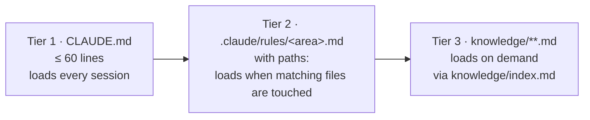

# Where things live

```
.sdlc/                         MACHINERY
  config.json                  your commands and overrides on plugin defaults (yours)
  scaffold.lock.json           what the plugin placed, versions, migrations (never edit)
  baseline.md                  failures from before setup (yours)
  state/<feature>.md           the agent's record: track, phase, plan, gate log, deviations
  state/<feature>/             work folder: backlog.md, plan-B<n>.md, qa-report.md, release.md
  state/<feature>.json         control contract + <feature>.events.jsonl (git-ignored)
  lint/                        lint snippets your ESLint/Ruff config imports (seeded)
  ci/invariants.py             CI check of reports, baseline, change files, test lock (seeded)
  ci/contract-check.sh         API contract check (multi-app repos that chose it; seeded)
  .work/                       scratch, git-ignored: verify record, freshness, dispatch log, findings
docs/sdlc/                     DOCUMENTS PEOPLE READ (docs_dir; setup asks if docs/ is a site)
  prd.md                       product doc: problem, audience, goals, capabilities (yours)
  constitution.md              project principles (yours)
  design-system.md             what UI work follows (UI projects; yours)
  recurring-defects.md         one line per defect Review found: Learn adds, Define and reviewers read
  changes/<feature>.md         the change file, the record for people (kept)
knowledge/                     tier 3: on-demand docs, linked from index.md
.claude/rules/<area>.md        tier 2: loads when matching paths are touched (yours)
.claude/rules/<stack>-<area>.md   stack conventions, written by the first feature in that area (yours)
.claude/rules/sdlc*.md         plugin policy rules (generated)
.claude/hookify/*.md           team hookify rules; sdlc-*.md are plugin guardrails (seeded)
.github/workflows/sdlc-verify.yml       CI from your commands (seeded)
.github/workflows/sdlc-invariants.yml   runs invariants.py on PRs and pushes (seeded)
CLAUDE.md                      tier 1, at most 60 lines (never touched by the plugin)
```

**Feature names:** `<yyyy-mm-dd>-<s|m|l>-<slug>`, or with a ticket `2026-10-22-m-PROJ-123-month-filter`. The letter is the starting track; sizing up later doesn't rename it. The branch uses the same name. Commit the state file, the change file and the work folder (`release.md` only if you want it).

**A workbench** ([ADR 0025](../adr/0025-workbench-for-multi-app-projects.md)) adds `workbench.json` at its root (each repo's folder, URL, role, owner, `write`, contract role), `contract/v<N>/openapi.yaml`, and one gitignored folder per cloned repo. App repos have their own config (`"workbench": "<name>"`), lock, CI and guardrails, but **no feature records**.

## `state.md`

Resume depends on this file: one `Status: active` file resumes, several asks which, none starts a new feature. It is written once from the template, filled in Define, then changed only through `scripts/state.py`, which also writes the control contract ([spec 12](../specs/12-control-contract.md)).

```markdown
# <feature>
Status: active
Process: 3
Change: <change>   (this feature's record for people)
Track: S | M | L   (sized up because: <named signal, or "—">; footprint: <n> files)
Risk: low | high   (<signal: auth, payments, secrets, PII, migration, public API>)
Top model: opus   (fable only if you chose it)
Commands: test: `<test command>`   (monorepo: one per package; no setup: the detected command)
Started: <date>
Base: <commit the feature started from>
Owner: <git email of whoever advances it>
Tool: <claude-code | codex | cursor | antigravity>
Verified: <commit> tree <worktree tree at the last passing verify>
Slice: B<n>   Slice base: <commit>   Slice gates: none   (work split into parts only)
Slice criteria: <criterion IDs>   (spec-backed: what the slice owes, from state.py new --criteria)
Current: Stage 1 – Define   (then Stage 2 – Build, Stage 3 – Review, Stage 4 – Ship)

## Stages            (1 Define, 2 Build, 3 Review, 4 Ship)
## How the build runs   (Define: inline, parts in fresh sessions or parallel subagents, and why)
## Handoff             (what the builder needs and wouldn't find in the code)
## Tasks               (numbered, each naming its files and ACs)
## Public Surface      (what the change adds that others can see, or - none)
## UI mapping          (UI work only)
## Gate log
## Deviations          (state.py deviation: "What: … Why: … Effect: …")
## Criteria            (spec-backed: each cited criterion's lock hash, state.py cite)
## Test lock           (M, L, S with guards.s_tests, and spec-backed: each test file's sha256 at its red run, verify.py red)
## Spec questions      (spec-backed: open questions on cited criteria, state.py question)
## Repos               (workbench: `<repo>: branch <b> base <commit>` or `<repo>: read <commit>`, state.py repo)
## PRs                 (workbench: `<repo>: <url>`, state.py pr; ship.py --status reads it)
## Open questions
```

Before advancing a feature with someone else's `Owner:`, the agent asks you and records the handover.

## Three-tier knowledge



Put in tier 1 only what nearly every task needs. **Learn** (before the final commit) files a lesson only if it isn't obvious from the code or commit, and links it from `## Review`, so it ships in the same PR. A decision later features must follow becomes a record in `knowledge/decisions/`, which Define treats as a constraint. Anything corrected twice that a machine can check becomes a [hookify rule](Rules-and-context.md#12-turn-a-correction-into-a-rule).

## By path

| What | Path |
|---|---|
| Project config | `.sdlc/config.json` |
| Scaffold version, placed files, migrations | `.sdlc/scaffold.lock.json` (never edit) |
| Known failures | `.sdlc/baseline.md` |
| Feature state (committed) | `.sdlc/state/<feature>.md` |
| Control contract (git-ignored) | `.sdlc/state/<feature>.json`, `<feature>.events.jsonl`, `<feature>.commands/` |
| Change file (committed) | `docs/sdlc/changes/<feature>.md` (`docs/sdlc` = `docs_dir`) |
| Living spec, if on | `docs/sdlc/capabilities/<name>.md` (old layout: `.sdlc/capabilities/`), written by Ship |
| Domain model, if on | `docs/sdlc/objects.md` (old layout: `.sdlc/objects.md`) |
| Work folder (committed) | `.sdlc/state/<feature>/`: `backlog.md`, `plan-B<n>.md`, `qa-report.md`, `release.md` (only if you ask) |
| Scratch (git-ignored) | `.sdlc/.work/`: `verify.json`, `verify-freshness.json`, `trust-anchor.json` (its `_config` entry: the mode and skips you accepted), `review-rounds.json` (per feature: round reached, rounds your answers allow, the cap's ceiling), `stuck-turn.json`, `dispatches.jsonl`, `findings/<feature>/` (review reports) |
| Ralph loop state | `.claude/ralph-loop.local.md` |
| Personal hookify rules | `.claude/hookify.<name>.local.md` (git-ignored) |
| Team hookify rules | `.claude/hookify/<name>.md` (committed) |
| Security hook state, reviewer venv | `$SECURITY_WARNINGS_STATE_DIR`, else `$CLAUDE_CONFIG_DIR/security/`, else `~/.claude/security/` (venv: `agent-sdk-venv`) |
